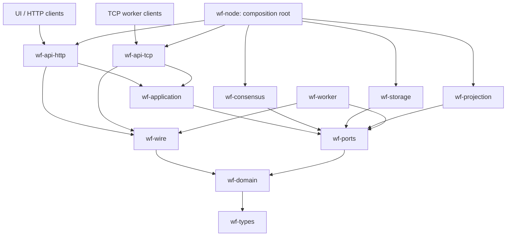

# Workflow runtime architecture

Status: reviewed architecture; M0 infrastructure and a partial pure M1 domain core are implemented. Storage, consensus, application and transport adapters remain scaffolds. This document owns module boundaries; implementation/review evidence and remaining gates live in the handoff and companion notes. Decisions that remain conditional must pass the implementation-plan gates.

## Purpose and scope

Build a durable workflow state machine in Rust, usable by worker clients and a future UI. Existing `apps/ferricstore/lib/ferricstore/flow/workflow.ex` describes explicit commands, leases, fencing and no Temporal-style replay. Its generated SDK calls the embedded Flow API. `flow/worker.ex` supplies polling convenience, rather than independent queue truth.

Include workflow creation, claiming, transitions, completion/failure, retry, lease extension/reclaim, cancellation, policies, schedules/signals, history, lineage and parent/child operations according to the parity matrix. Broader governance, approvals, budgets, durable effects and durable steps require explicit supported/deferred/dropped dispositions at the preimplementation parity gate; they are not silently excluded. These may be delivered in stages; unsupported commands must be explicit. Keep durable payloads/results and workflow indexes because workflow correctness requires them. Exclude general KV, Redis compatibility, arbitrary data structures, unrelated pubsub, SQL surface and existing dashboards. Authentication, bounded requests, observability, configuration, backups and cluster administration are operational necessities, not a port of unrelated products.

Assumption: “functional like code to ease UI work” means a pure state-transition core and stable data contracts consumable by a UI; it does not require a Rust frontend or a UI implementation now.

The pinned production backend selects WARaft (`raft/backend.ex`); its command clock carries leader HLC/wall inputs (`raft/command_clock.ex`). OpenRaft is a Rust migration candidate, with no existing log/wire compatibility promised. See [source provenance](source-provenance.md) for the targeted baseline read.

## Fundamental model

Use Rust structs, enums and traits rather than inheritance or classes with mutable hidden state. Newtypes make TenantId, WorkflowId, PartitionId, GroupId, RecoveryId, RequestId, LeaseToken, Fence, Revision and AppliedPosition distinct. Public fields are allowed for validated immutable read models; constructors validate command input. Internal mutable state remains private.

The Raft group is the atomicity boundary, matching the inspected baseline. A logical partition is an ordering/routing scope, not necessarily a separate transaction boundary. A bounded command may touch multiple logical partitions when authoritative placement verifies they share a group. Route related workflows using a stable, versioned partition encoding. Initially operate one Raft group with several logical partitions if needed; do not make live resharding an MVP prerequisite. The routing strategy cannot rely on Rust's randomized HashMap hasher. Related parent/child changes must stay within one group-local consensus transaction; cross-group fanout requires a separately designed saga and must be rejected until supported. Placement and atomicity must be validated server-side rather than trusted from client routing hints.

One authority owns each workflow's durable state. Consensus commits commands, the domain deterministically applies them, storage persists authoritative state and derived indexes in an atomic batch. Read projections and caches never decide lease validity, FIFO order, eligibility or authorization.

## HTTP and TCP client transports

Both HTTPS and a dedicated TLS/TCP workflow API are first-class design targets. Separate adapters share one node-owned application service, authorization policy, tenant/group admission and durable outcome behavior. See [transport design](transport-design.md), [HTTP](transports/http.md), [TCP](transports/tcp.md) and [operations/conformance](transports/operations-and-conformance.md). [ADR-001](adr/001-dual-client-transports.md) replaces the initial single `wf-api` proposal with the following explicit boundaries; historical review notes may retain the earlier name. Both remain unimplemented.

## Workspace boundaries

The M0 crate boundaries below are scaffolded; types and domain operations are implemented incrementally against pinned source assertions. [ADR-002](adr/002-project-foundation.md) adds isolated test-support/parity tooling, and [ADR-003](adr/003-source-size-limits.md) enforces source-size limits. Avoid generic `utils`, `common`, `manager` or a catch-all backend crate. Small cohesive modules can share a crate if they have the same allowed dependency set, but enforce every logical boundary. Separate domain and adapter crates are mandatory.

| Crate | Modules and principal types | Allowed first-party dependencies |
|---|---|---|
| `wf-types` | identity, version, bounded values, errors; stable primitive newtypes | none |
| `wf-domain` | workflow, claim, lease, retry, policy, signal, schedule, lineage, history, retention; Command, Event, WorkflowState, TransitionPlan | types |
| `wf-ports` | ConsensusPort, AuthoritativeReadPort, ProjectionReadPort, BlobPort, Clock, IdSource, NotificationPort, WorkflowClientPort; consistency and capability contracts | types, domain |
| `wf-application` | admission, command preparation, query services, routing, response mapping; WorkflowService, QueryService | types, domain, ports |
| `wf-storage` | log, state, transaction, snapshot staging, blob lifecycle; durable adapters | types, domain, ports |
| `wf-consensus` | Raft adapter, committed apply, membership, leader reads; PartitionReplica | types, domain, ports |
| `wf-projection` | history/list/lineage read models, checkpoints, rebuild, cache; projection adapters | types, domain, ports |
| `wf-wire` | pure versioned public DTOs, scalar/operation/error encodings, capabilities | types, domain (approved values only) |
| `wf-api-http` | HTTP extraction/encoding, TLS/auth credential acquisition, request lifecycle | types, domain, wire, application |
| `wf-api-tcp` | safe framing/session/call correlation, TLS/auth credential acquisition, request lifecycle | types, domain, wire, application |
| `wf-worker` | client contract, claim loop, handler outcomes, heartbeat, shutdown; Worker, HandlerOutcome | types, domain, ports; wire only in private client adapters |
| `wf-node` | configuration, wiring, supervision, lifecycle and telemetry setup | all above |
| `wf-architecture-tests` | executable Cargo/architecture policy and negative fixtures; never a runtime dependency | tooling only |
| `wf-test-support` | isolated test resources, controlled clocks and acknowledged fault barriers | tooling/test dependencies only; no runtime dependencies on this crate |
| `wf-parity-tests` | preserved snapshot integrity and fail-closed parity evidence checks | tooling only |

`wf-consensus` accesses storage through ports, not `wf-storage`; `wf-node` wires concrete adapters. Use narrow log/state-machine/snapshot ports in `wf-ports` with consensus-neutral types. A local bridge type owned by `wf-consensus` implements OpenRaft traits and delegates to those ports; `wf-storage` implements the neutral ports, and node wires the instances. This makes trait ownership explicit without a storage-to-consensus edge. Do not expose OpenRaft types in the domain or API. Validate that the selected OpenRaft release can satisfy this layout in the adapter spike; change it only through an ADR if a concrete trait constraint demands it.

Arrows mean code dependency, not request direction. Crate edges are an allowlist; all features, build dependencies and target-specific dependencies are checked. Within ports, worker may reference only the client-facing module and approved value contracts; its wire dependency is restricted to client-adapter modules; both API adapters receive narrow application services and wire contracts rather than raw consensus/transaction capabilities. They cannot import ports/storage/consensus or bypass application authorization/admission. wf-wire cannot import effect/runtime/server crates. Public API/compile-fail and parsed module rules must check these restrictions, with review for macro/facade blind spots. Tests may import test-support through dev-dependencies but cannot introduce runtime dependency cycles. Node and other production crates cannot depend on any of the three tooling/test-support crates. Public module scaffolds are reservations, not stable implemented APIs; no stub reports successful workflow behavior.

## Principal structs and trait contracts

These are design contracts, not source implementations. Keep lifecycle and logical work state distinct: `WorkflowStatus` includes scheduled/ready/running/waiting/terminal categories; `RunState` names the handler state. Final variants must match the source parity decision.

| Type / owner | Data and responsibility | Operations / constraints |
|---|---|---|
| `WorkflowDefinition` / domain policy | Type, initial state, state policies, definition version | Validate definition, resolve state policy; policy installation is a committed command |
| `WorkflowRecord` / domain workflow | Identity, partition, logical state/status, revision, attempt count, deadline, lineage, payload/result refs | Read-only state view; mutation only through transition plans |
| `Lease` / domain lease | Worker identity, opaque lease token, monotonic fence, expiration | Validate ownership and expiration; token secrecy is distinct from fence ordering |
| `CommandEnvelope` / domain | Tenant, caller-bound group/recovery request scope, request identity, format version, explicit time/IDs, typed command | Bounded admission; request identity includes stable canonical client-intent digest to reject reuse for different input |
| `Command` / domain | Enum of create, claim, transition, retry, terminal, lease, signal, child/policy/schedule operations | Each operation names required guards, touched partitions within one group and bounded batch limits |
| `TransitionPlan` / domain | Validated record mutations, authoritative index changes, history events, response | Atomic persistence unit; excludes network calls, user handlers and cache effects |
| `CommandOutcome` / domain/application | Accepted result or deterministic rejection, applied position, request identity | Client also has an `UnknownOutcome` transport state; do not equate timeout with rejection |
| `WorkflowView` / ports/application | Immutable query data, allowed actions, revision, freshness/consistency metadata | No raw backend handles; distinguish missing, omitted and unavailable payload |
| `ChildGroup` / domain lineage | Parent, children, wait mode, resolution and sibling policy | Bound group size; idempotent parent resolution in same transaction boundary |
| `ProjectionCheckpoint` / ports | Group/epoch, applied position, schema version | Prevent invalid comparison across groups or restarted epochs |
| `WorkflowService` / application | Explicit ports, admission limits, routing policy | Submit commands; query authoritative outcomes; never mutate domain state before commit |
| `QueryService` / application | Explicit authoritative/projected read ports | Enforce tenant scope, cursor contract and requested watermark |
| `Worker` / worker | Workflow client port, handler callback, concurrency/poll/heartbeat limits | Claim, invoke external handler, report typed outcome; stop claiming then drain on shutdown |
| `PartitionReplica` / consensus | Raft lifecycle, storage-neutral ports and apply bridge | Replicate, apply, strong-read barrier, snapshot and membership coordination |
| `NodeRuntime` / node | Owned adapter handles, shutdown tasks and configuration | Composition and supervision only; no workflow business rules |

Ports expose semantic capabilities rather than backend APIs. `ConsensusPort.submit` distinguishes durable outcome, redirect/unavailable, and uncertain result. `AuthoritativeReadPort` accepts a strong-read requirement and group position. `ProjectionReadPort` declares its watermark. `StateTransactionPort` supplies a coherent authoritative read view and atomically writes a transition plus outcome/checkpoint; `RaftLogPort` persists vote/log with ordered durable acknowledgments; `SnapshotPort` stages, verifies and installs complete snapshots. Exact signatures belong to the future adapter spike. None exports OpenRaft, redb, cache guard or HTTP response types inward.

Introduce a distinct `WorkflowClientPort` for worker claim/extend/outcome/reconciliation operations. HTTP and TCP worker client adapters may import `wf-wire` DTOs within their approved private client modules; handler/claim-loop modules remain transport-free. HTTP and TCP worker client adapters can be private modules of `wf-worker` initially, or split into outer `wf-client-http`/`wf-client-tcp` crates once separate reuse/dependency policies justify them. They implement WorkflowClientPort without linking server adapters or calling consensus directly. Both `wf-api-http` and `wf-api-tcp` delegate to application rather than implementing worker semantics again.

Small pure value types may use standard collections and selected pure helper dependencies. The dependency policy separately classifies permitted external libraries; first-party arrows alone do not guarantee functional purity.

## Functional core

Target contracts; the implemented single-record reducer covers part of `decide`
and produces bounded proposed writes. Remaining contracts require their milestone
gates:

- `validate(raw_command, limits) -> Result<ValidatedCommand, ValidationError>`: no I/O.
- `prepare(validated_command, authoritative_view, explicit_inputs) -> PreparedCommand`: leader-side preparation, never a final commit decision.
- `decide(state_view, committed_command) -> Result<TransitionPlan, DomainError>`: pure deterministic business rules and precondition validation.
- `apply(state, transition_plan) -> updated_state`: deterministic state update, bounded to touched records.
- `project(event_batch, read_model) -> next_read_model`: deterministic derivation.
- `present(workflow_view) -> read_contract`: explicit read model, separate transport serialization.

No async, Tokio, threads, wall clocks, randomness, environment, networking, filesystem, caches or logging effects in `wf-domain`. Time, generated IDs and randomness needed for a transition are explicit committed inputs. Do not clone a whole partition for every command: use bounded read views and write sets. Determinism covers serialization versions, sorted iteration when producing output, overflow, retry rounding and tie-breaks.

Application code performs effects through ports. The same domain validation and state rules serve HTTP, dedicated TCP, embedded access and workers. The UI receives stable enums, structured field errors and allowed actions computed by domain rules. Allowed actions are advisory: committed state must revalidate every mutation.

## Command execution and durability

1. Authenticate and enforce tenant, request and payload bounds at the edge. Construct typed command and idempotency key.
2. Route to the leader. Prepare explicit time/IDs and bounded candidate inputs as necessary. Keep stable request identity and caller-bound original group/recovery namespace across redirects and retry; verify placement and reject incompatible scope before proposal.
3. Submit a versioned command through Raft. Replicas revalidate all state-dependent conditions while applying the same committed entry. Invalid committed commands produce deterministic rejections without partial mutation.
4. Persist workflow changes, correctness-critical indexes, idempotency outcome, durable history and last-applied position atomically. Do not return success from an in-memory update alone.
5. Reply after committed application and required persistence. Unknown outcomes after timeout are queried/retried with the same request identity. External effects are at-least-once unless the external system enforces idempotency.
6. Publish derived read updates from durable events/checkpoints. A crash cannot lose the only copy of an event required to rebuild a projection.

Claim selection is especially sensitive: never commit only a leader's stale unchecked selection. The preferred initial strategy commits a bounded claim request (scope, limit, worker, lease duration and explicit time) and selects wholly from replicated authoritative indexes during apply, using a specified total ordering. This avoids leader-candidate races. A candidate-hint optimization is deferred; it would require full deterministic revalidation and proof that hints cannot change FIFO/fairness semantics. A failed candidate cannot silently permit breaking FIFO. Claim replies carry unique lease identity, monotonic fencing identity and durable deadlines.

A single ordered apply owner per group holds a coherent authoritative view across decision and transaction. The next entry cannot decide from state preceding an unfinished earlier commit. Publish updated in-memory state only after persistence succeeds. Storage failure/corruption is a replica failure, not a DomainError or an empty read: do not advance last-applied; fail-stop or retry under the Raft storage contract. Persist deterministic business rejections and their request outcomes with the applied checkpoint. Already-applied entries do not mint fresh fences or duplicate history.

Deduplication is checked before evaluating changed lease/revision preconditions on retried client requests. Its key is tenant + group + recovery identity + request identity, with a canonical client-intent digest excluding leader-generated time/IDs. The prepared entry has a separate immutable identity. Original request_scope is discovered and retained before first submission; incompatible scope rejects before proposal, including after waits/forwarding. Equivalent retries return the original persisted outcome; reusing an ID with different intent rejects. Placement changes cannot strand outcomes: initial live group migration is unsupported, and future migration must move dedup state and routing atomically or preserve a lookup redirect. Retention must declare when original-outcome guarantees expire. Current tenant authorization still applies before returning a retained outcome. Canonical digest encoding preserves opaque bytes, explicit guards and meaningful batch order; excludes credentials, trace IDs and routing hints; rejects duplicate fields/ambiguous numbers; and versions default normalization. Freeze cross-SDK golden vectors before exposing mutation retries.

Correctness-critical due/FIFO/ownership indexes are authoritative transactional structures, even when derivable from records. Restore must load or rebuild them before enabling claims. Disposable cache/projection indexes remain outside this authority. Claim requests have a maximum scan/work budget and explicit partial/continuation semantics; a budget cannot permit skipping a FIFO head. A partial result must distinguish budget exhaustion with continuation from no eligible work. It may claim eligible heads of other lanes but never skip a live head within one FIFO lane. These limits and exact tie-breaks must be frozen with M1 fixtures.

Client scheduling timestamps are requested deadlines, not authority to advance group time; only admitted leader-prepared time inputs participate in the proposed clock policy. The time ADR must define advancement for accepted, rejected, duplicate, tick and membership entries consistently, with replay preserving the original dedup outcome.

Initial payload design is bounded inline bytes/results in replicated commands and snapshots; reject oversized references until a replicated blob availability protocol is validated.

Proposed group time is nondecreasing committed logical time, with bounded committed ticks for idle expiration progress. This is deterministic but needs an explicit clock-skew/forward-jump/new-leader policy before deployment; it does not by itself prove physical-time lease safety. Snapshot and restore preserve logical time and fence identity. Disaster restore requires a new recovery identity or externally safe fence namespace to reject stale members/workers. See the Raft note for snapshot staging, vote/log completion, read barriers and membership gates.

No user handler executes inside Raft apply. Slow I/O and blob hydration do not block the domain reducer; the adapter must bound queues and document ordering/backpressure. Persist payload bytes before accepting a reference, and prove they remain available to every possible apply/snapshot path; local preupload alone is insufficient. A simpler bounded inline payload design is acceptable initially.

Legacy workflow APIs without explicit request IDs also have source-tested lease/fence duplicate-effect behavior. Preserve those current-history/operation guard semantics through the compatibility path; do not assign a shared request ID to repeated legacy test calls to simulate them. A legacy retry may become stale after an intervening transition, whereas an explicit retained request-ID retry returns its original outcome. These distinct contracts need separate acceptance cases and compatibility mapping before implementation. Authoritative lane-head indexing must preserve source deep-FIFO selection cases even when many earlier-due followers fill scan windows; work limits cannot weaken them.

## Read contracts and UI ergonomics

Strong `get`, lease and control reads use a leader/quorum read barrier and wait for applied position. Projection-backed list/history queries expose consistency mode and watermark; consumers can request at least the position returned by a write. Never label stale list results linearizable. A client write position uses stable group/log identity, distinct from a projection-local recovery generation. Ordinary restart or snapshot installation preserves the authoritative identity; a rebuilt projection must prove incorporation of retained positions before satisfying read-your-write. A disaster restore with a new recovery/cluster identity returns an explicit incompatible-position result for old positions. Do not silently compare different generations numerically. History durability and materialized query freshness are distinct.

DTOs contain stable status tags, revision, timestamps, lease metadata with sensitive token redaction, payload sizes/refs, lineage, policy version and typed error codes. Pagination uses opaque versioned cursors with tenant/query scope and ordering tie-breaks; mixed-watermark pages need a declared contract. Mutation DTOs accept expected revision and request identity. Separate public wire DTOs from persisted schema and OpenRaft types.

Authorize tenant/query scope before cache lookup. A strong read first establishes a leader/quorum barrier and coherent authoritative revision; cached values must match that tenant, identity, revision and schema. A client-supplied revision or cache invalidation alone is not freshness proof. Release cache guards before await.

Use explicit capabilities/tenant context at application boundaries. Tenant filtering is mandatory for every query and cache key. Future streaming notifications are hints with resume/checkpoint semantics, never the sole workflow history or truth layer. Document request/response schema versions and compatibility policy before SDK work.

## Existing workflow regression baseline

The existing Elixir workflow suites are mandatory acceptance inputs, preserved with source/hash provenance and a [port contract](workflow-test-parity.md). Every included scenario and assertion must have a passing Rust counterpart; property and architecture tests supplement that baseline. Do not treat copied Elixir sources as runnable Rust tests, or count deferred/ignored cases as parity. Rust adapter changes require equivalent tests for the original durability and boundedness guarantees.

## Safety and evolution

Forbid unsafe code in first-party domain, application, wire, HTTP/TCP API, worker and coordination crates. Start with no first-party unsafe anywhere. An unavoidable unsafe adapter needs a separate audited boundary, ADR explaining safe alternatives rejected, safety invariant, Miri/sanitizer or equivalent evidence and a narrow safe facade. Dependencies may contain unsafe; audit them and pin approved versions rather than claiming the whole program is unsafe-free.

Prefer ownership and bounded message passing over shared locks. Do not hold locks across await. Async interfaces are justified at effect boundaries; pure functions remain synchronous. Avoid speculative trait abstractions: a trait must represent a real effect or substitution used by testing.

Schema, command and snapshot versions are independent. Rollout must reject unsupported commands before proposing them; every voting replica must understand committed commands. Retention cannot delete live blob references, idempotency guarantees, pending child accounting or snapshot recovery data. Policy upgrades require explicit semantics for existing leased jobs.

Architecture changes require a short ADR with motivation, changed allowlist, failure cases, migration and tests. Dependency inversion and invariants are enforced in CI as specified in the Rust quality note. Reviewers must distinguish mechanical checks from properties that require fault testing or human review.
