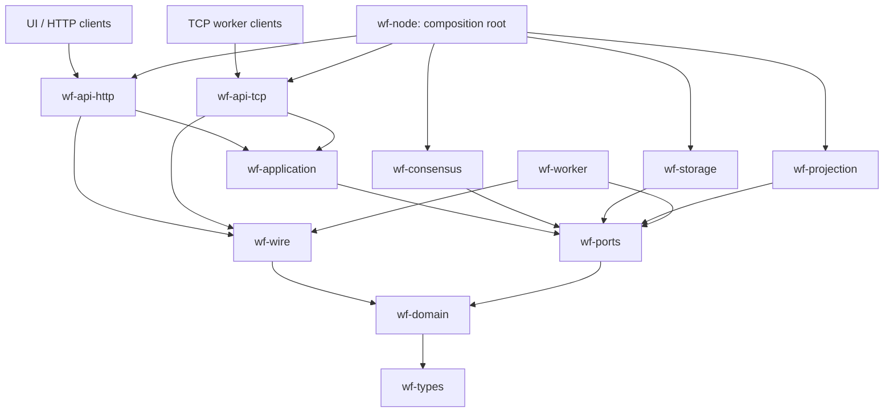

# Workflow runtime architecture

Status: reviewed architecture; M0 infrastructure and a partial pure M1 domain core are implemented. Storage, consensus, application and transport adapters remain scaffolds. This document owns module boundaries; implementation/review evidence and remaining gates live in the handoff and companion notes. Decisions that remain conditional must pass the implementation-plan gates.

## Purpose and scope

Build a durable workflow state machine in Rust, usable by worker clients and a future UI. Existing `apps/ferricstore/lib/ferricstore/flow/workflow.ex` describes explicit commands, leases, fencing and no Temporal-style replay. Its generated SDK calls the embedded Flow API. `flow/worker.ex` supplies polling convenience, rather than independent queue truth.

Include workflow creation, claiming, transitions, completion/failure, retry, lease extension/reclaim, cancellation, policies, schedules/signals, history, lineage and parent/child operations according to the parity matrix. Broader governance, approvals, budgets, durable effects and durable steps require explicit supported/deferred/dropped dispositions at the preimplementation parity gate; they are not silently excluded. These may be delivered in stages; unsupported commands must be explicit. Keep durable payloads/results and workflow indexes because workflow correctness requires them. Exclude general KV, Redis compatibility, arbitrary data structures, unrelated pubsub, SQL surface and existing dashboards. Authentication, bounded requests, observability, configuration, backups and cluster administration are operational necessities, not a port of unrelated products.

Assumption: “functional like code to ease UI work” means a pure state-transition core and stable data contracts consumable by a UI; it does not require a Rust frontend or a UI implementation now.

The pinned production backend selects WARaft (`raft/backend.ex`); its command clock carries leader HLC/wall inputs (`raft/command_clock.ex`). OpenRaft is a Rust migration candidate, with no existing log/wire compatibility promised. See [source provenance](source-provenance.md) for the targeted baseline read.

## Fundamental model

Use Rust structs, enums and traits rather than inheritance or classes with mutable hidden state. Newtypes make TenantId, WorkflowId, PartitionId, GroupId, RecoveryId, RequestId, LeaseToken, Fence, Revision and AppliedPosition distinct. Public fields are allowed for validated immutable read models; constructors validate command input. Internal mutable state remains private.

The Raft group is the atomicity boundary, matching the inspected baseline. A logical partition is an ordering/routing scope, not necessarily a separate transaction boundary. A bounded command may touch multiple logical partitions when authoritative placement verifies they share a group. Route related workflows using a stable, versioned partition encoding. Initially operate one Raft group with several logical partitions if needed; do not make live resharding an MVP prerequisite. The routing strategy cannot rely on Rust's randomized HashMap hasher. Related parent/child changes must stay within one group-local consensus transaction; cross-group fanout requires a separately designed saga and must be rejected until supported. Placement and atomicity must be validated server-side rather than trusted from client routing hints.

One authority owns each workflow's durable state. Consensus commits commands, the domain deterministically applies them, storage persists authoritative state and derived indexes in an atomic batch. Read projections and caches never decide lease validity, FIFO order, eligibility or authorization.

## HTTP and TCP client transports

Both HTTPS and a dedicated TLS/TCP workflow API are first-class design targets. Separate adapters share one node-owned application service, authorization policy, tenant/group admission and durable outcome behavior. See [transport design](transport-design.md), [HTTP](transports/http.md), [TCP](transports/tcp.md) and [operations/conformance](transports/operations-and-conformance.md). [ADR-001](adr/001-dual-client-transports.md) replaces the initial single `wf-api` proposal with the following explicit boundaries; historical review notes may retain the earlier name. Both remain unimplemented.

## Workspace boundaries

The M0 crate boundaries below are scaffolded; types and domain operations are implemented incrementally against pinned source assertions. [ADR-002](adr/002-project-foundation.md) adds isolated test-support/parity tooling, and [ADR-003](adr/003-source-size-limits.md) enforces source-size limits. Avoid generic `utils`, `common`, `manager` or a catch-all backend crate. Small cohesive modules can share a crate if they have the same allowed dependency set, but enforce every logical boundary. Separate domain and adapter crates are mandatory.

| Crate | Modules and principal types | Allowed first-party dependencies |
|---|---|---|
| `wf-types` | identity, version, bounded values, errors; stable primitive newtypes | none |
| `wf-domain` | workflow, claim, lease, retry, policy, signal, schedule, lineage, history, retention; Command, Event, WorkflowState, TransitionPlan | types |
| `wf-ports` | ConsensusPort, AuthoritativeReadPort, ProjectionReadPort, BlobPort, Clock, IdSource, NotificationPort, WorkflowClientPort; consistency and capability contracts | types, domain |
| `wf-application` | admission, command preparation, query services, routing, response mapping; WorkflowService, QueryService | types, domain, ports |
| `wf-storage` | log, state, transaction, snapshot staging, blob lifecycle; durable adapters | types, domain, ports |
| `wf-consensus` | Raft adapter, committed apply, membership, leader reads; PartitionReplica | types, domain, ports |
| `wf-projection` | history/list/lineage read models, checkpoints, rebuild, cache; projection adapters | types, domain, ports |
| `wf-wire` | pure versioned public DTOs, scalar/operation/error encodings, capabilities | types, domain (approved values only) |
| `wf-api-http` | HTTP extraction/encoding, TLS/auth credential acquisition, request lifecycle | types, domain, wire, application |
| `wf-api-tcp` | safe framing/session/call correlation, TLS/auth credential acquisition, request lifecycle | types, domain, wire, application |
| `wf-worker` | client contract, claim loop, handler outcomes, heartbeat, shutdown; Worker, HandlerOutcome | types, domain, ports; wire only in private client adapters |
| `wf-node` | configuration, wiring, supervision, lifecycle and telemetry setup | all above |
| `wf-architecture-tests` | executable Cargo/architecture policy and negative fixtures; never a runtime dependency | tooling only |
| `wf-test-support` | isolated test resources, controlled clocks and acknowledged fault barriers | tooling/test dependencies only; no runtime dependencies on this crate |
| `wf-parity-tests` | preserved snapshot integrity and fail-closed parity evidence checks | tooling only |

`wf-consensus` accesses storage through ports, not `wf-storage`; `wf-node` wires concrete adapters. Use narrow log/state-machine/snapshot ports in `wf-ports` with consensus-neutral types. A local bridge type owned by `wf-consensus` implements OpenRaft traits and delegates to those ports; `wf-storage` implements the neutral ports, and node wires the instances. This makes trait ownership explicit without a storage-to-consensus edge. Do not expose OpenRaft types in the domain or API. Validate that the selected OpenRaft release can satisfy this layout in the adapter spike; change it only through an ADR if a concrete trait constraint demands it.

Arrows mean code dependency, not request direction. Crate edges are an allowlist; all features, build dependencies and target-specific dependencies are checked. Within ports, worker may reference only the client-facing module and approved value contracts; its wire dependency is restricted to client-adapter modules; both API adapters receive narrow application services and wire contracts rather than raw consensus/transaction capabilities. They cannot import ports/storage/consensus or bypass application authorization/admission. wf-wire cannot import effect/runtime/server crates. Public API/compile-fail and parsed module rules must check these restrictions, with review for macro/facade blind spots. Tests may import test-support through dev-dependencies but cannot introduce runtime dependency cycles. Node and other production crates cannot depend on any of the three tooling/test-support crates. Public module scaffolds are reservations, not stable implemented APIs; no stub reports successful workflow behavior.

## Principal structs and trait contracts

These are design contracts, not source implementations. Keep lifecycle and logical work state distinct: `WorkflowStatus` includes scheduled/ready/running/waiting/terminal categories; `RunState` names the handler state. Final variants must match the source parity decision.

| Type / owner | Data and responsibility | Operations / constraints |
|---|---|---|
| `WorkflowDefinition` / domain policy | Type, initial state, state policies, definition version | Validate definition, resolve state policy; policy installation is a committed command |
| `WorkflowRecord` / domain workflow | Identity, partition, logical state/status, revision, attempt count, deadline, lineage, payload/result refs | Read-only state view; mutation only through transition plans |
| `Lease` / domain lease | Worker identity, opaque lease token, monotonic fence, expiration | Validate ownership and expiration; token secrecy is distinct from fence ordering |
| `CommandEnvelope` / domain | Tenant, caller-bound group/recovery request scope, request identity, format version, explicit time/IDs, typed command | Bounded admission; request identity includes stable canonical client-intent digest to reject reuse for different input |
| `Command` / domain | Enum of create, claim, transition, retry, terminal, lease, signal, child/policy/schedule operations | Each operation names required guards, touched partitions within one group and bounded batch limits |
| `TransitionPlan` / domain | Validated record mutations, authoritative index changes, history events, response | Atomic persistence unit; excludes network calls, user handlers and cache effects |
| `CommandOutcome` / domain/application | Accepted result or deterministic rejection, applied position, request identity | Client also has an `UnknownOutcome` transport state; do not equate timeout with rejection |
| `WorkflowView` / ports/application | Immutable query data, allowed actions, revision, freshness/consistency metadata | No raw backend handles; distinguish missing, omitted and unavailable payload |
| `ChildGroup` / domain lineage | Parent, children, wait mode, resolution and sibling policy | Bound group size; idempotent parent resolution in same transaction boundary |
| `ProjectionCheckpoint` / ports | Group/epoch, applied position, schema version | Prevent invalid comparison across groups or restarted epochs |
| `WorkflowService` / application | Explicit ports, admission limits, routing policy | Submit commands; query authoritative outcomes; never mutate domain state before commit |
| `QueryService` / application | Explicit authoritative/projected read ports | Enforce tenant scope, cursor contract and requested watermark |
| `Worker` / worker | Workflow client port, handler callback, concurrency/poll/heartbeat limits | Claim, invoke external handler, report typed outcome; stop claiming then drain on shutdown |
| `PartitionReplica` / consensus | Raft lifecycle, storage-neutral ports and apply bridge | Replicate, apply, strong-read barrier, snapshot and membership coordination |
| `NodeRuntime` / node | Owned adapter handles, shutdown tasks and configuration | Composition and supervision only; no workflow business rules |

Ports expose semantic capabilities rather than backend APIs. `ConsensusPort.submit` distinguishes durable outcome, redirect/unavailable, and uncertain result. `AuthoritativeReadPort` accepts a strong-read requirement and group position. `ProjectionReadPort` declares its watermark. `StateTransactionPort` supplies a coherent authoritative read view and atomically writes a transition plus outcome/checkpoint; `RaftLogPort` persists vote/log with ordered durable acknowledgments; `SnapshotPort` stages, verifies and installs complete snapshots. Exact signatures belong to the future adapter spike. None exports OpenRaft, redb, cache guard or HTTP response types inward.

Introduce a distinct `WorkflowClientPort` for worker claim/extend/outcome/reconciliation operations. HTTP and TCP worker client adapters may import `wf-wire` DTOs within their approved private client modules; handler/claim-loop modules remain transport-free. HTTP and TCP worker client adapters can be private modules of `wf-worker` initially, or split into outer `wf-client-http`/`wf-client-tcp` crates once separate reuse/dependency policies justify them. They implement WorkflowClientPort without linking server adapters or calling consensus directly. Both `wf-api-http` and `wf-api-tcp` delegate to application rather than implementing worker semantics again.

Small pure value types may use standard collections and selected pure helper dependencies. The dependency policy separately classifies permitted external libraries; first-party arrows alone do not guarantee functional purity.

## Functional core

Target contracts; the implemented single-record reducer covers part of `decide`
and produces bounded proposed writes. Remaining contracts require their milestone
gates:

- `validate(raw_command, limits) -> Result<ValidatedCommand, ValidationError>`: no I/O.
- `prepare(validated_command, authoritative_view, explicit_inputs) -> PreparedCommand`: leader-side preparation, never a final commit decision.
- `decide(state_view, committed_command) -> Result<TransitionPlan, DomainError>`: pure deterministic business rules and precondition validation.
- `apply(state, transition_plan) -> updated_state`: deterministic state update, bounded to touched records.
- `project(event_batch, read_model) -> next_read_model`: deterministic derivation.
- `present(workflow_view) -> read_contract`: explicit read model, separate transport serialization.

No async, Tokio, threads, wall clocks, randomness, environment, networking, filesystem, caches or logging effects in `wf-domain`. Time, generated IDs and randomness needed for a transition are explicit committed inputs. Do not clone a whole partition for every command: use bounded read views and write sets. Determinism covers serialization versions, sorted iteration when producing output, overflow, retry rounding and tie-breaks.

Application code performs effects through ports. The same domain validation and state rules serve HTTP, dedicated TCP, embedded access and workers. The UI receives stable enums, structured field errors and allowed actions computed by domain rules. Allowed actions are advisory: committed state must revalidate every mutation.

## Command execution and durability

1. Authenticate and enforce tenant, request and payload bounds at the edge. Construct typed command and idempotency key.
2. Route to the leader. Prepare explicit time/IDs and bounded candidate inputs as necessary. Keep stable request identity and caller-bound original group/recovery namespace across redirects and retry; verify placement and reject incompatible scope before proposal.
3. Submit a versioned command through Raft. Replicas revalidate all state-dependent conditions while applying the same committed entry. Invalid committed commands produce deterministic rejections without partial mutation.
4. Persist workflow changes, correctness-critical indexes, idempotency outcome, durable history and last-applied position atomically. Do not return success from an in-memory update alone.
5. Reply after committed application and required persistence. Unknown outcomes after timeout are queried/retried with the same request identity. External effects are at-least-once unless the external system enforces idempotency.
6. Publish derived read updates from durable events/checkpoints. A crash cannot lose the only copy of an event required to rebuild a projection.

Claim selection is especially sensitive: never commit only a leader's stale unchecked selection. The preferred initial strategy commits a bounded claim request (scope, limit, worker, lease duration and explicit time) and selects wholly from replicated authoritative indexes during apply, using a specified total ordering. This avoids leader-candidate races. A candidate-hint optimization is deferred; it would require full deterministic revalidation and proof that hints cannot change FIFO/fairness semantics. A failed candidate cannot silently permit breaking FIFO. Claim replies carry unique lease identity, monotonic fencing identity and durable deadlines.

A single ordered apply owner per group holds a coherent authoritative view across decision and transaction. The next entry cannot decide from state preceding an unfinished earlier commit. Publish updated in-memory state only after persistence succeeds. Storage failure/corruption is a replica failure, not a DomainError or an empty read: do not advance last-applied; fail-stop or retry under the Raft storage contract. Persist deterministic business rejections and their request outcomes with the applied checkpoint. Already-applied entries do not mint fresh fences or duplicate history.

Deduplication is checked before evaluating changed lease/revision preconditions on retried client requests. Its key is tenant + group + recovery identity + request identity, with a canonical client-intent digest excluding leader-generated time/IDs. The prepared entry has a separate immutable identity. Original request_scope is discovered and retained before first submission; incompatible scope rejects before proposal, including after waits/forwarding. Equivalent retries return the original persisted outcome; reusing an ID with different intent rejects. Placement changes cannot strand outcomes: initial live group migration is unsupported, and future migration must move dedup state and routing atomically or preserve a lookup redirect. Retention must declare when original-outcome guarantees expire. Current tenant authorization still applies before returning a retained outcome. Canonical digest encoding preserves opaque bytes, explicit guards and meaningful batch order; excludes credentials, trace IDs and routing hints; rejects duplicate fields/ambiguous numbers; and versions default normalization. Freeze cross-SDK golden vectors before exposing mutation retries.

Correctness-critical due/FIFO/ownership indexes are authoritative transactional structures, even when derivable from records. Restore must load or rebuild them before enabling claims. Disposable cache/projection indexes remain outside this authority. Claim requests have a maximum scan/work budget and explicit partial/continuation semantics; a budget cannot permit skipping a FIFO head. A partial result must distinguish budget exhaustion with continuation from no eligible work. It may claim eligible heads of other lanes but never skip a live head within one FIFO lane. These limits and exact tie-breaks must be frozen with M1 fixtures.

Client scheduling timestamps are requested deadlines, not authority to advance group time; only admitted leader-prepared time inputs participate. [ADR-004](adr/004-committed-time-and-apply-admission.md) selects consistent advancement for accepted, rejected, duplicate, tick and stamped membership entries, with unchanged clocks for unstamped consensus entries and original dedup outcomes preserved. Live skew/forward-jump/new-leader safety still requires adapter evidence.

Initial payload design is bounded inline bytes/results in replicated commands and snapshots; reject oversized references until a replicated blob availability protocol is validated.

Selected group time is nondecreasing committed logical time, with bounded committed ticks for idle expiration progress under ADR-004. This is deterministic but needs an explicit clock-skew/forward-jump/new-leader policy before deployment; it does not by itself prove physical-time lease safety. Snapshot and restore preserve logical time and fence identity. Disaster restore requires a new recovery identity or externally safe fence namespace to reject stale members/workers. See the Raft note for snapshot staging, vote/log completion, read barriers and membership gates.

No user handler executes inside Raft apply. Slow I/O and blob hydration do not block the domain reducer; the adapter must bound queues and document ordering/backpressure. Persist payload bytes before accepting a reference, and prove they remain available to every possible apply/snapshot path; local preupload alone is insufficient. A simpler bounded inline payload design is acceptable initially.

Legacy workflow APIs without explicit request IDs also have source-tested lease/fence duplicate-effect behavior. Preserve those current-history/operation guard semantics through the compatibility path; do not assign a shared request ID to repeated legacy test calls to simulate them. A legacy retry may become stale after an intervening transition, whereas an explicit retained request-ID retry returns its original outcome. These distinct contracts need separate acceptance cases and compatibility mapping before implementation. Authoritative lane-head indexing must preserve source deep-FIFO selection cases even when many earlier-due followers fill scan windows; work limits cannot weaken them.

## Read contracts and UI ergonomics

Strong `get`, lease and control reads use a leader/quorum read barrier and wait for applied position. Projection-backed list/history queries expose consistency mode and watermark; consumers can request at least the position returned by a write. Never label stale list results linearizable. A client write position uses stable group/log identity, distinct from a projection-local recovery generation. Ordinary restart or snapshot installation preserves the authoritative identity; a rebuilt projection must prove incorporation of retained positions before satisfying read-your-write. A disaster restore with a new recovery/cluster identity returns an explicit incompatible-position result for old positions. Do not silently compare different generations numerically. History durability and materialized query freshness are distinct.

DTOs contain stable status tags, revision, timestamps, lease metadata with sensitive token redaction, payload sizes/refs, lineage, policy version and typed error codes. Pagination uses opaque versioned cursors with tenant/query scope and ordering tie-breaks; mixed-watermark pages need a declared contract. Mutation DTOs accept expected revision and request identity. Separate public wire DTOs from persisted schema and OpenRaft types.

Authorize tenant/query scope before cache lookup. A strong read first establishes a leader/quorum barrier and coherent authoritative revision; cached values must match that tenant, identity, revision and schema. A client-supplied revision or cache invalidation alone is not freshness proof. Release cache guards before await.

Use explicit capabilities/tenant context at application boundaries. Tenant filtering is mandatory for every query and cache key. Future streaming notifications are hints with resume/checkpoint semantics, never the sole workflow history or truth layer. Document request/response schema versions and compatibility policy before SDK work.

## Existing workflow regression baseline

The existing Elixir workflow suites are mandatory acceptance inputs, preserved with source/hash provenance and a [port contract](workflow-test-parity.md). Every included scenario and assertion must have a passing Rust counterpart; property and architecture tests supplement that baseline. Do not treat copied Elixir sources as runnable Rust tests, or count deferred/ignored cases as parity. Rust adapter changes require equivalent tests for the original durability and boundedness guarantees.

## Safety and evolution

Forbid unsafe code in first-party domain, application, wire, HTTP/TCP API, worker and coordination crates. Start with no first-party unsafe anywhere. An unavoidable unsafe adapter needs a separate audited boundary, ADR explaining safe alternatives rejected, safety invariant, Miri/sanitizer or equivalent evidence and a narrow safe facade. Dependencies may contain unsafe; audit them and pin approved versions rather than claiming the whole program is unsafe-free.

Prefer ownership and bounded message passing over shared locks. Do not hold locks across await. Async interfaces are justified at effect boundaries; pure functions remain synchronous. Avoid speculative trait abstractions: a trait must represent a real effect or substitution used by testing.

Schema, command and snapshot versions are independent. Rollout must reject unsupported commands before proposing them; every voting replica must understand committed commands. Retention cannot delete live blob references, idempotency guarantees, pending child accounting or snapshot recovery data. Policy upgrades require explicit semantics for existing leased jobs.

Architecture changes require a short ADR with motivation, changed allowlist, failure cases, migration and tests. Dependency inversion and invariants are enforced in CI as specified in the Rust quality note. Reviewers must distinguish mechanical checks from properties that require fault testing or human review.

## Complete normalized policy VALUE bytes

The reviewed A-V2VAL1 exception assigns the canonical FWPS/FWPV version-2 complete policy VALUE grammar and pure prepare/decode/stream verification to the private domain implementation. Existing V1 and FWCP framing, dispatch, namespace binding and actual hashing stay in ports. This adds no domain dependency or effect/OS access. One shared logical schema account pays every selected visit; its existing peak scratch metric does not certify total live owners or native resource use. See [ADR006](adr/006-private-prepared-command-codec.md) for the responsibility, version and validation limits. Independent Linux and macOS execution remains required.

The private `policy/complete/presentation.rs` owns pure All/State response values
with independent query and policy lifetimes. It verifies present V2 content once
on the received schema account, then borrows original version, indexed, retry
target and raw governance leaves. All owns a bounded, fallibly reserved vector
of borrowed state descriptors; State has no all-state collection. Some state
governance selects the whole present group, including empty groups, before type
fallback; All rows expose only their own group. Captured public retention
defaults resolve without an apply-context history clamp. Only an explicitly
supplied absent observation becomes generation zero. These mathematical values
leave configuration capture, authoritative reads, public maps/transports and
durable installation to their existing owners; logical fees and borrowed
addresses do not certify native resource gains on either supported host.

## Complete replacement caller and generation-free intent

A-M1-OUTER2-I1 selects the typed normalized caller/intent predecessor. Its
creation contract is reviewed; body/TDD/native acceptance is recorded separately.
The private domain outer feature owns actual caller header checks, immutable
content/cap ownership, intent measurement and closed prospective logical
stream/hash scheduling on the caller's same mutable PolicySchemaCharge. Ports
owns the private one-stream actual SHA branch and uses its existing exact hash
dependency. Types/domain gain no hash, effect, OS or backwards dependency.

Caller getters and immutable cap copies are mathematical content, not charge
identity, verification, authorization, storage or parent authority. The ports
entry accepts raw owned Input, prepares it on its actual received account and
hashes its real fields. No accepted-Caller reencoder/public debit/credit/flag or
intent-output Vec/reference spine is introduced. The temporary measured view
reads actual borrowed operands in its one paid walk and drops before Input moves.
Separate stream/SHA fees are conservative logical work; actual ports performs
one interleaved traversal and claims no three-payload-scan native cost.

The new normalized intent2 grammar preserves every complete field, Option,
enum, raw-byte map order and normalized list order, with fixed big-endian widths.
Tenant and explicit guard are included; assigned generation, wrappers, group,
recovery, request and committed time are excluded. Existing app V1 comparison
and ClientIntent::new stay exact. P retains max canonical scratch rather than
total live-owner or native memory semantics. See
[ADR005](adr/005-application-intent-hash-helper.md) and
[ADR006](adr/006-private-prepared-command-codec.md) for the selected limits.

Stage F framing/restoration/models/ClientIntent2, ONE retained gate and coherent
atomic authoritative parent remain separate required steps. Raw Patch/aliases/
nil/ETF/reference hashing/customer versions, all original public scenarios and
profiles, and later runtime milestones remain acceptance work. Linux and macOS
require independent current checks and matched native resource/performance
evidence; local Darwin tests and old CI do not certify current Linux changes.

## Original core-Patch caller and intent

A-NEXT1-CONSULT selects the Stage I owner and identity of the original normalized
partial core Patch. Private domain outer/caller/core_patch owns pure header
checks, bounded borrowed measurement and prospective stream/hash scheduling on
the actual received PolicySchemaCharge. Private ports log/complete_policy/
core_patch owns the real immutable field-to-SHA traversal using the existing
exact hash dependency. Domain remains std/wf-types-only, with no effects, SHA,
OS access or backwards dependency. The two caller owners and ports Intent have
private fields, immutable getters and no derives or paid-credit API.

The 33-byte COMPLETE-CORE-PATCH V2 registry includes tenant, type, original guard
and every original partial field. Unchanged/Clear/Set-empty, optional Backoff
components and state Remove/Patch remain distinct, without default expansion.
Current policy, migration high-water, captured context and resulting VALUE/
generation are excluded together with group/recovery/request/stamp/log. Original
partial identity must survive retry/replay and later remerge against ordered
coherent current state; a leader-prepared VALUE cannot replace it.

The closed ports entry admits raw owned input on its same passed account, hashes
that immutable owner once and moves it into Intent. Private measured metadata
and immutable cap copies convey no account identity or install authority. Actual
RAW/count/Option/FieldPatch visits and separate stream/SHA prospective payments
remain bounded and nonrollback. P is canonical scratch maximum, not owner SUM
or native allocation/Drop/CPU/RSS/latency. Existing Complete-Replace methods,
measure/hasher bodies, goldens and V1/VALUE/FWCP boundaries remain exact.

ADR005 and ADR006 record the full registry, fees and tests-first hold. The
existing codec architecture test adds the exact new domain-path positive and
effect-negative controls plus forbidden client-facade intent leakage; dependency
policy and source-checker rules remain unchanged. Full literals and six readable
tests precede creation/RED; S0 is separately selected. Stage F, ONE retained gate,
Fresh remerge, atomic parent, raw/public parity, all profiles and independent
Linux AND macOS source/native/performance acceptance remain separate successors.

## Borrowed original core-Patch frame verification

A-NEXT-F1-CREATE1 selects private domain outer/core_patch_frame with its scan
child, private ports log/complete_policy/core_patch/frame and one test child.
Domain remains synchronous std/wf-types-only and hash-free. Existing Reader
module/type/thirteen methods widen only within policy::complete; every body,
field and optional callback keeps its contract. Ports reuses the exact existing
SHA dependency and fallible FWSC codec, with no client-facade exposure.

A private-field mathematical ScannedCorePatchFrame exposes only its original
intent borrow and is consumed for header restoration. It carries no account,
paid count, token or credit. The sole raw ports verifier freshly admits on one
actual charge, hashes the bound region, compares its digest before header copies
and late scope/frame tails, then privately constructs Verified. Early structural
scope admission remains before intent comparison. No accepted-view/header hash,
public wrapper constructor, Patch materialization, current-policy access or gate
is selected. Legacy tags 1–3/public V1 and held Replace tag 4 remain unchanged.

ADR006 records registry, phase and resource limits. Existing architecture checks
cover both new domain descendants and forbid Verified leakage through client.
No dependency or source-rule exception is added. Full six-test source/ordinary
fit, TDD, strict checks and both hosts remain gates. Original partial Stage F,
Fresh-only ONE retained gate, coherent remerge/atomic parent, raw/public profiles
and native allocation/performance/live-owner measurements remain successors.

## Original core-Patch frame production

A-NEXT-F2-CREATE1 extends the existing private caller/core_patch and ports
core_patch/frame responsibilities. Domain pays bounded original/header
measurement and each prospective hash/reserve/emission event on the actual
received account. Ports freshly accepts raw owned input and returns only
existing PreparedBytes after fallible full-frame output and exact length/SHA.
The unchanged original Caller remains the source for header and payload.

One private CompletePolicyIntentSink grammar serves exactly existing IntentHasher and
Writer; no new production module, model, hash dependency or domain effect is
introduced. Existing verifier and V1/legacy/Replace boundaries remain exact.
Three private test children under the existing core_patch integration module
keep ordinary physical file/function limits and fixed independent byte oracles.
ADR006 records separate phase payments and ownership limits. Source reuse does
not establish native performance or Linux acceptance; consuming decoder,
retained gate, Fresh remerge, atomic parent and full test parity remain required.

The selected original Complete Replace frame contract adds private domain
outer/replace_frame with its scan child and private ports complete_policy/replace.
Domain owns mathematical grammar, paid header restoration and structural list
uniqueness; ports owns actual hashing and fallible FWCP/FWSC output. Format1/tag6
preserves the original full generation-free intent, independent of assigned
generation, current policy and defaults. The shared intent visitor serves both
hashing and frame emission. Existing caller/Core Patch behavior and the V2
field scan remain intact through the narrowly reviewed sink/tail extractions.

The new producer admits borrowed list uniqueness after measurement/frame caps
and before output prepayments, rejecting duplicates as operational Malformed.
This adds no semantic normalization, current reads, gate or retained authority.
Verification compares the original intent before header copies and owns no Data.
The codec is implemented after tests-only RED; its six controls pass within the
48-test target, and macOS workspace source checks pass. Consuming decoding has a
separately selected contract below; Fresh retained-request application remains
subsequent work. ADR006 records accounting/ownership limits. Dependency and purity rules
stay unchanged; full original parity and independent Linux/macOS execution remain
required.

The consuming Replace decoder adds only private decode children to
domain outer/replace_frame and ports complete_policy/replace. Ports verifies raw
bytes once on the same schema account, then privately consumes the verified
result. Domain freshly reconstructs the original guard and Data, moving existing
header identities into the input. The immutable decoded model owns that input
and the moved FWSC vector while borrowing original frame/intent bytes. It has no
public constructor, Clone or accepted-Verified entry point.

The existing V2 owning decoder shares its exact Data field tail. Both original
snapshot roots still precede FWPS/version reads. Replace reconstruction pays
every reached read and owner occurrence, preserves field presence and original
list order, and adds no defaults, business admission, current lookup or gate.
Input decomposition moves all five existing fields. This codec gives no Fresh,
retained-request, installation or physical publication authority. Its six tests
follow genuine missing-API RED and pass within the 54-test target. All macOS
workspace source checks pass; actual source reciprocal review is closed.
Online advisory refresh, Linux execution and original public/setup/profile
parity remain open.

## Consuming original core-Patch frame decoding

A-NEXT-F3-CREATE1 selects private decode children within the existing domain
outer/core_patch_frame and ports core_patch/frame responsibilities. Domain
consumes the immutable scanned header and reconstructs the exact original
partial command; boxed header IDs move into its raw request input. Ports
verifies raw bytes first on the same schema account, privately consumes the
verified result, and retains borrowed frame/intent bytes with moved isolation.
DecodedCompleteCorePolicyPatchFrame has private fields and no public constructor.

Reconstruction freshly pays every reached read, comparison and owned leaf copy.
Original presence and business-invalid values survive without normalization or
current-policy access. Reader optional/copy visibility widens only inside
policy::complete; domain remains synchronous, hash-free and std/wf-types-only.
The existing architecture checks cover the decoder and forbid its client-facade
exposure. No dependency, source-size or allocation-accounting exception is added.

The raw codec grants no retained-request, Fresh or installation authority. An
ordered apply parent must verify, run exactly one retained gate, and only on
Fresh reconstruct the original command before coherent current-policy/CAS,
context, highwater, paid remerge and atomic write decisions. That parent is a
separate successor. ADR006 records fresh fees and live-owner limits. Native
Linux/macOS execution, complete original scenarios and measured performance
remain independently required.

## Charged original core-Patch request replay gate

A/P-NEXT-F4-GATE1 selects the existing workflow/request/gate.rs responsibility.
The charged entry and legacy inspect_request share one algorithm, one control
plan and one retained-map lookup. A private optional account preserves the old
legacy decisions and validation order; the charged entry checks its immutable
profile and prospectively charges each reached event on the received account.
Only complete's profile getter/debit helper and restricted reexport widen to
crate visibility. No dependency, module rule or source-size waiver is added.

The returned RequestGate borrows only the coherent view's retained outcomes.
Its header lifetime is independent, allowing the result to survive a temporary
verified-header owner. Fresh, Replay, IntentConflict, Expired and LogReplay,
original retained response/status/identity/time/expiry and proposed control
remain mathematical data. The gate reads no Patch, current policy, context,
CAS, highwater or transaction, and grants no byte-binding/install authority.

Four tests cover lifetime, old/charged decisions and validation priority, every
prospective refusal, wider identity lengths, repeated same-account owners and
real prior scratch peaks. Genuine missing-API and rejecting-body failures
precede the shared implementation; native evidence remains host-specific.
The separate raw parent must freshly verify, invoke this gate once and only
for Fresh reconstruct/remerge before coherent atomic proposed writes. Full
original profiles, Linux/macOS acceptance and durable adapters remain required.

## Fresh-only original core-Patch request parent

A/P-NEXT-F4-PARENT2-BODY1 selects private domain complete/request and ports
core_patch/frame/apply children. The raw ports entry verifies once, gates once,
returns non-Fresh decisions directly and reconstructs only Fresh on the same
schema charge. Domain validates present current authority before CAS, then
restores/merges with captured context, checks active before completed migration
high-water and constructs the assigned full VALUE and original retained outcome.
The unchanged standalone Patch entry retains its original guard-first priority.

The required-revision View contains borrowed maps and Result-valued authority,
context and retention inputs. The private-field Plan owns proposed Fresh values
or borrows original replay solely from the external view. Accepted Fresh proposes
policy/predecessor, outcome and control together; business rejection proposes
outcome/control. Operational failures expose no partial Plan. Private accepted
response version1 contains the entire original canonical FWPV2 envelope; public
presentation remains a separate contract. ADR006 records fees and ownership.

Six tests execute independent full-byte/metadata, error-origin/order, continuous
account/refusal, replay and sequential-writer controls. These pure supplied views
implement neither physical ordered reads nor atomic namespace/revision/control/
predecessor comparison and publication. Strict reader/configuration adapters,
public/original profiles, full Elixir parity, durability and separate Linux AND
macOS acceptance remain required. Architecture checks cover both private children
and forbid server/parent capability leakage through client and wire facades.

## Source-ordered normalized Complete Replace content

A-NEXT-M1-COMPLETE-REPLACE-CONTENT1-CREATE1 and the reciprocal performance
creation decision select private domain replace_content with core, governance,
indexed and rejection children. Its mathematical checker borrows Data, checks
the immutable account profile and captured history context, runs unchanged
operational complete_metrics, pays semantic stream and peak scratch, then
visits representable business fields once in pinned Elixir source order.
Operational caps, correspondence and noncanonical duplicates return outer
errors; no schema-error conversion can manufacture the private rejection.

The immutable rejection contains only its restricted reason and, for history,
the admitted original limit. Exact source response construction freshly pays
the actual received account and uses static literals or a seven-byte local
decimal buffer, then one fallibly reserved output Vec. No Data cloning, default
expansion, VALUE installation, generation, retained status or Fresh authority
is selected here. Multiple invalid typed map entries follow raw-byte BTreeMap
order; general Elixir map first-error equivalence remains unproved. Existing
standalone/core-Patch business order and payments remain unchanged.

Six controls now execute after genuine tests-only missing-API RED; the policy
target passes 51/51. Independent supplemental response-fee assertions were
added after implementation and pass in the same 51-test target. The macOS
workspace passes 478 Rust tests and four compile-fail docs, strict source lint,
architecture, documentation and reference checks. Its wrapper stops only at
online RustSec DNS; a separate configured October 9 cached audit passes all
four categories. Final actual-source reciprocal review is closed without blockers.
Logical scratch does not bound allocator/tree/live-owner/Drop/CPU/RSS costs;
there is no measured resource gain. Original raw/public/ETF/setup/profile
parity, physical atomic publication and independent Linux validation remain
required alongside macOS.

## Fresh-only original Complete Replace request parent

A-NEXT-M1-COMPLETE-REPLACE-PARENT1-CREATE1 selects private domain
complete/replace_request with its retention child and private ports
complete_policy/replace/apply. The parent is implemented after genuine
missing-API RED. All eight new controls and 54 existing controls pass within
the 62-test target; strict library and target Clippy pass. Actual source review
and reciprocal architecture/performance review are closed without blockers.
The complete macOS workspace wrapper passes 487 Rust tests, four compile-fail
docs and every source/dependency stage; the 62-test target overlaps that total.
The existing codec architecture
test checks both domain
descendants, the ports module, forbidden dependency back-edges and client/wire
capability leakage. Its one focused macOS control passes.

The raw ports entry verifies once, runs the existing charged header gate once
and returns non-Fresh decisions before reconstruction or fresh authority reads.
Fresh consumes the same verified frame and checks present V2 correspondence,
then CAS, then requested type. Captured context precedes one incoming content
walk, active and completed migration reads, and assigned generation. Only the
three generation business reasons or the actual content descriptor reach
retention. A private Result alias owns accepted predecessor/value or a bounded
two-arm business rejection; outer operational errors remain separate.
Operational failures return no partial plan. Old CorePatch and
standalone priorities retain their existing contracts.

The seven-field supplied View preserves revision, control, Result-valued reads
and captured configuration. The private-field Plan owns the complete proposed
policy/predecessor, original outcome and control bundle, or borrows the original
replay outcome from the external view. Accepted response version1 retains the
entire original private VALUE with one paid copy; a content-error encoder's
Vec moves into retention without a second copy. The retained content status
preserves its original history limit. The original window and aggregate cap
precede metadata and response allocation.

This typed contract accepts positive normalized V2 current values and original
normalized replacement Data. Existing public snapshot binding can construct
mathematical byte-mismatch fixtures without an unchecked API; it supplies no
physical reader proof. Original generation0/raw/ETF/public normalization,
indexed catalog and migration-queue writes, coherent physical reads, full
compare/atomic publication, all original profiles and independent Linux AND
macOS validation remain required. ADR006 records logical fees and native
ownership limits; no measured performance gain is claimed.

## Original indexed-policy input normalization

A-NEXT-M1-POLICY-INDEXED-INGRESS1-CREATE1 selects private complete/indexed_input
and its key child, with two private children in the existing policy test target.
The implementation follows genuine tests-only missing-API RED; all six new
controls and existing tests pass in the 58-test policy target with strict lint.
The full macOS wrapper passes 495 Rust tests and four compile-fail docs.
Written-source architecture/performance review and their reciprocal review
are closed without blockers. The exact three exports are a
borrowed Nil/Binary/Atom/List/Other input view, thirteen fixed source rejection
reasons, and one normalization function returning the existing optional owned
indexed fields. No dependency, wire format, retained status or authority model
is added. The existing architecture checker covers both descendants and rejects
client/wire/domain-value forwarding; its focused control and strict lint pass.

The operation preflights both raw trees with explicit depth, occurrence and byte
bounds on the received schema account. Then attributes precede metadata: UTF-8,
source whitespace trimming, empty/trimmed-byte/reserved checks, stable first
occurrence, and source unique limits of three attribute names and one key per
metadata list. Each nested list completes its local check before the next outer
sibling. Missing attributes differ from present nil/empty lists; nil metadata
disappears. Only after both fields succeed are final unique leaves copied into
their existing owners. ADR006 records the fixed logical schedule and limits.

This purpose-specific shape view does not parse arbitrary Elixir terms or whole
raw policy options. Original public replies, strict ETF/generation-zero readers,
physical configuration/index/migration/atomic operations, required runtime
profiles and independent Linux/macOS execution remain acceptance obligations.

## Original stored retry-key inspection

A-NEXT-M1-ORIGINAL-RETRY-KEYS1-CREATE1 selects private complete/original_retry_keys
and its map child, plus two private children of the existing policy test target.
The exact two borrowed key/value class enums and one paid boolean function are
implemented after genuine tests-only missing-API RED. All 64 policy controls and
strict target lint pass; the full macOS wrapper passes502 Rust tests and four
compile-fail docs with all source/dependency stages. Written-source architecture
and performance reviews and their reciprocal review are closed without blockers. The existing architecture
checker now covers both descendants and rejects client/wire/domain-value
forwarding. Its focused control, formatting and strict library lint pass.

The operation preflights visible map/key/value descriptors before
semantic lookup. Top-level atom-key presence shadows binary keys even for a
nonmap value; state rows use the original guarded atom-map preference and
binary-map fallback. Old-key membership ignores the associated value, and
reached root/state results short-circuit. The operation borrows inputs and
returns no owner or current-policy authority. Other classes hide payload
identity; descriptor bounds and queried-key duplicate handling do not validate
arbitrary terms or general map uniqueness. ADR006 records the logical schedule.

The original raw entry reader below integrates this predicate through bounded
paid backing and the shared borrowed-span visitor. That construction uses temporary
owners. Original raw parent integration and all required public/setup/profile/
physical and both-OS acceptance remain separate obligations.

## Implemented original raw entry reader

A-NEXT-M1-ORIGINAL-ENTRY1-CREATE1 selects private complete/original_entry with
eight responsibility-specific children and the private ports reference child.
Reciprocal creation consultation and actual written-source architecture/performance
review are closed. All six test children preceded production with genuine missing-API
RED; domain72/72 and ports65/65 pass. The existing checker passes its new purity and
server-facade control, with no inspector, dependency or policy exception.

Domain takes original ETF bytes and borrowed atom/export/local-node/function
context as mathematical inputs. It checks the encoded cap, complete safe term,
original three-tuple and generation0..MAX before the shared deprecated-key
predicate. Arbitrary maps remain distinct from normalized business admission.
The separate read adapter preserves absence, corruption, unavailable and failed
read origins, then binds only atom:type with a binary semantic value. No
constructor or returned entry proves physical reads, current authority or
runtime-context coherence. Existing parent priorities stay unchanged.

Two freshly charged lexical passes surround three fallible temporary Vec
reservations. Flat spans, map key order and local-function overlays drop before
the returned entry borrows original bytes. The shared private map visitor has
exactly the old descriptor and raw-span adapters; the old result and fee controls
pass unchanged. The raw ports constructor calls a purpose-specific domain byte-preparation
function once, then hashes its exact output into one PreparedBytes owner. The
pure helper copies original present bytes or emits the source generation-zero/
type-map absence fallback on the same account, prospectively paying SHA and
reference metadata. It accepts raw read classes and grants no debit or Entry-input
bridge; metadata refusal may precede actual native hashing.
It retains only the query borrow; public Policy absence stays0/nil.

The selected portable profile models64-bit OTP28.3.1 with explicit operational
depth/span/capture limits and distinct unsupported-runtime errors. It does not
replace the broader required source profiles. Captured and first-created local
functions, source reference branches, semantic map uniqueness and ignored
subtrees have executed controls. LOCAL, native atom indexes73/75, empty BIT len0/
bits0 and zero-word NEW/NEWER references are explicit operational exclusions.
The zero-word native outcome is unknown; ordinary empty BINARY and valid1..5
reference branches retain their selected semantics. ADR006 records prospective work and scratch
scheduling. There is no measured native gain or complete original setup/public/
physical/profile acceptance; Linux and macOS remain independent requirements.

## Implemented original-current replacement composition

A-NEXT-M1-ORIGINAL-CURRENT-REPLACE1-CREATE1 selects one private
`replace_request/original.rs` child with the original-current View and error models.
The existing ports parent gains its original-current entry, and existing Plan,
Fresh and retained-status models are reused. All eight new tests preceded
production with genuine missing-API RED independently reproduced by the coordinator.
All 73 controls and strict domain/ports lint pass. The three test children and
private architecture control follow the reciprocal creation decision.
Actual source architecture/performance review is mutually closed without blockers.

Gate replay lifetime is separate from raw current maps/bytes and captured runtime
catalogs. Supplied read classes distinguish a confirmed miss from a nonbinary HIT.
Fresh performs strict envelope/generation decoding before CAS, then atom:type
binding, followed by the shared incoming-only content/migration/allocation/encoding
tail and retention. The source's two immutable decodes are represented by one full
fresh decode plus the reached post-CAS comparison. Stored arbitrary map content
is discarded for replacement without business re-admission or cloning.

Common parent failures wrap the existing replacement error. Reached decoder and
type-comparison work errors retain the original reader encoding origin; strict
current/type corruption uses the allocator's exact high-water message. Only incoming
content descriptors and allowed generation decisions enter retained outcomes.
The existing normalized V2, CorePatch, standalone and public Policy priorities,
interfaces and fee streams remain acceptance controls. No dependency or inspector
exception is selected; domain remains synchronous and pure.

The output remains the selected private V2 semantic encoding. Original ETF output,
raw migration/option/retry normalization, public projections, physical coherent
reads and atomic publication remain required work. Logical source-derived fees
do not certify native allocation, stack, latency or gain. Full required source
profiles and independent Linux/macOS execution remain mandatory.

## Implemented original retry input normalization

A-NEXT-M1-POLICY-RETRY-INGRESS1-CREATE1 selects private `retry_input.rs` and
`retry_input/value.rs`, two children of the existing complete-policy test target,
and the existing normalized `RetryPolicy`/`RetryOverride` output models. Two new
enums represent borrowed raw value classes and ten fixed source diagnoses;
`OriginalPolicyMapKey` is reused. Creation consultation and reciprocal resource
review are closed. Eight meaningful tests preceded production with genuine
missing-API RED independently reproduced by the coordinator; all 80 policy
controls and strict target lint pass. Actual architecture/performance source and
mapping review is mutually closed without blockers.

The two three-operand APIs take a borrowed value, schema limits and the received
continuous account. They distinguish full nil defaults from absent overrides,
empty supplied overrides and present backoff groups with all scalar defaults.
Atom presence shadows binary keys; keywords select the last duplicate. Source
validation order and exact error bodies remain separate from operational limits.
Exhausted targets are nonempty opaque bytes except exact `running`. A base delay
greater than its maximum remains a valid input.

Preflight bounds the entire visible descriptor tree, including ignored/shadowed
values and repeated aliases. Descriptor depth/count/text limits do not certify
hidden payload size, arbitrary source-map identity, raw parsing or ETF safety.
Fresh field scans reuse no payment credit and materialize no temporary map.
After every semantic check, output metadata and one fallible target reservation
precede the final copy into the existing model. Target-free overrides allocate
no target Vec. Logical scratch remains independent of native memory or speed.

The private checker child is approved to move from `original_current.rs` to
`original_policy.rs`, preserving its existing body before adding retry boundary
checks. The parent changes only its module name and stays within 600 lines.
Original full-flow/state option order, public/physical operations, complete
runtime profiles and independent Linux/macOS acceptance remain required.

## Implemented original retention input normalization

A-NEXT-M1-POLICY-RETENTION-INGRESS1-CREATE1 selects one private
`complete/retention_input.rs` and two children of the existing policy test target.
The optional normalizer reuses the existing borrowed retry-value vocabulary and
Copy retention override, with one four-variant caller diagnosis and a separate
exact-body encoder. Six meaningful tests preceded production with genuine
missing-API RED independently reproduced by Root. All86 policy controls and
strict target lint pass; actual source/mapping review is mutually closed without
blockers. No dependency or module-rule exception is added.

At the retention checkpoint the private selector widened only to
`policy::complete`, with its body and old retry fees preserved. The subsequent
whole-flow batch replaces that seam with a shared paid cursor selector while
preserving the existing public event streams. Retention owns
its three-name preflight and preserves TTL, internal hot-key membership, then
history validation against the original captured limit. Missing fields stay
missing. The scalar result needs no output allocation; only the separate body
encoder reserves one Vec. Captured limits are immutable mathematical inputs,
with no environment read, full-default merge, Fresh or installation authority.

Visible descriptor bounds and prospective work preserve one received account;
logical scratch does not measure native allocation, stack, memory or speed.
Whole-flow raw order, ETF sizing/emission, public/atomic physical publication,
complete runtime profiles and independent Linux/macOS execution remain required.

## Implemented original whole-flow normalization

A-NEXT-M1-ORIGINAL-FLOW-INGRESS1-CREATE1 approves a borrowed whole-flow input
view, source-ordered normalization and deterministic original ETF snapshot output.
Fourteen private production children group cursor/preflight/layout, core/states,
governance, binary map ordering and ETF responsibilities under complete/flow_input.
The selected cursor has actual substitutions in the old retry/indexed wrappers;
sharing borrowed semantic staging must preserve every old public event stream.
Seven existing-target test children preceded production with independently
reproduced missing-API RED; subsequent source-based test corrections are recorded.
All100 policy controls and strict workspace lint pass. The macOS wrapper passes
554 Rust tests, four compile-fail doc tests and every source check, then fails
at its default RustSec refresh because GitHub DNS resolution is unavailable.
The first failed real-workspace architecture epoch and its local self::core
qualification correction remain recorded; no checker exception was added.
Actual source/mapping review and reciprocal architecture/performance review are
closed without blockers for this component.

Arbitrary nonnegative customer integers remain exact; existing u64-only V2 models
are not silently widened or used to narrow this input. Nil atoms remain distinct
from proper empty lists. Binary state-pair maps collapse their last duplicates
before the release-profile32-key ordering threshold. Portable fixed-width binary
ordering/fingerprint arithmetic reproduces the pinned64LE OTP profile; request
identity SHA remains in ports. This is no permission for random or runtime hashing.

One bounded raw preflight and incoming business walk stage borrowed cells. The
late governance1MiB and whole-snapshot262144 limits use the original normalized
ETF subset; the final output has one fallible Vec reservation. The full source
public/frame/retained/Fresh/atomic successor is required separately. This snapshot
owner carries no installation, origin or payment authority. Logical work/peak
accounting does not establish native allocation or speed. Complete runtime profiles
and independent Linux/macOS execution remain mandatory.

## Implemented original whole-flow replacement parent

A-NEXT-M1-ORIGINAL-FLOW-PARENT1-CREATE1 adds eleven privately grouped production
files under the existing domain complete-policy and ports log boundaries. The
lower replace=true command has registry-three mathematical intent and a captured
source-order sidecar; domain remains synchronous and hash-free, with actual SHA
in ports. One bounded borrowed verifier and one existing retained-request gate
precede Fresh. Non-Fresh bypasses all changed current/context/migration/window
reads. Fresh returns owned proposed key/value/response data and coherent compare
inputs, with no physical publication or service authority.

Current decoding and raw CAS precede atom:type binding, captured limits and one
incoming source-ordered normalization. The same private layout and checked bare
snapshot length survive migration high-water allocation and direct original ETF
envelope emission. There is no intermediate snapshot Vec or second admission
pass. Current decoder indexes drop before incoming layout allocation; only this
parent widens encoded spans to263168 so it can read its valid output. Existing
public4096-span readers and standalone normalization retain their old behavior.
The installation bytes and retained response remain separately paid owners.

The source-order sidecar proves relative correspondence conditional on faithful
capture; it does not attest VM origin. Raw Other's operational UnsupportedTag is
a temporary required opaque-identity gap, not an approved product exclusion.
Public Policy.set preprocessing/replies, complete source/setup/runtime profiles,
physical atomic/all-shard publication and independent Linux execution remain
required. The final macOS wrapper passes567 Rust tests, four compile-fail docs
and every infrastructure stage; direct source-ledger anchors remain separate.
Compact ordinal staging, linear inverse validation and direct same-layout
emission are source-level improvements, with no measured native gain claimed.

## Selected original public Policy.set frame and merge

ARCH-NEXT-M1-ORIGINAL-PUBLIC-MERGE-CREATE1 selects eighteen private production
files under the existing complete-policy and ports log boundaries. Twelve new
test identities preceded production with independently reproduced missing-API
RED. All selected bodies now exist. Integrated verification has595 passing
Rust tests and four compile-fail docs,
with strict workspace lint and all source checks passing. The wrapper then
fails at the default RustSec GitHub DNS refresh; a separate cached October14
audit passes all four categories. Neither that audit nor the preceding complete
582-test checkpoint certifies a fresh dependency refresh or native Linux run.
Written-source architecture/performance and reciprocal reviews are closed
without a remaining component blocker.

Registry four binds the public prepared patch, both replace modes, optional raw
reply selector and generation guard. The whole-frame digest additionally covers
the captured patch-order sidecar, which is excluded from canonical intent.
Domain measures and
encodes deterministically without hashing. Ports owns the actual patch, intent
and whole-frame hashes, one structural verifier and one retained-request gate.
Non-Fresh decisions bypass current policy, limits, migration and retention reads.
Borrowed capture correspondence is conditional on faithful ingress; it does not
attest native VM enumeration order or origin.

Fresh strictly decodes current bytes before CAS and atom-type binding. True
replacement drops the current index before normalization. False replacement uses
a bounded retained-current index and a four-owner merge arena, preserving exact
keys, source aliases, reached Enumerable guards and resolved-state nil deletion.
Current data is not independently business-readmitted before an overwriting
patch can rescue it. One joined layout validates surviving values, then retains
that same layout through late migration generation and original ETF emission.
The separately owned installation and retained response outlive all borrowed
frame, current, capture and layout owners.

New-only current decoding admits 263168 encoded spans and uses the same measured
span bound for the deprecated-map visitor. Old public 4096 profiles and event
streams remain unchanged. Logical peak accounting sums live current indexes,
capture backing, arena and layout reservations, final ETF and key owners before
allocation; it separately admits retained metadata plus the installation and
response after transient owners drop. This is bounded resource accounting, with
no native allocation or latency measurement. The core adds no OS-specific API.
Public reply projection, opaque ingress identity and coherent VM capture,
physical atomic/all-shard publication, all original assertion/setup/runtime
profiles and independent Linux/macOS validation remain required.

## Original public policy reply views

The selected private domain reply implementation borrows original ETF donors
and explicit caller defaults, sharing the structural index and type defaults
across state views. Generic values preserve exact map-key classes and source
fallback/error order. Public observations use the same logical resource account
with explicit simultaneously live caller owners. No storage, clock, hash or
transport dependency enters the domain. The real Fresh/Replay caller test uses
existing immutable plans; physical publication remains an adapter obligation.
See [ADR006](adr/006-private-prepared-command-codec.md) for the selected contract
and remaining opaque ingress identity, custom Enumerable support and runtime
acceptance requirements.

## Original public policy GET boundary

Pure domain GET preparation preserves complete keyword validation followed by
type, FIRST state and key-size checks. It owns only the temporary routing key;
ignored option values receive no patch conversion or hidden-payload authority.
The original policy reader capability and caller are grouped under
`wf-ports::state::policy`. One allocator-zero read follows fresh preparation,
then the key owner drops before the existing borrowed reply projection.

This narrow source compatibility interface exposes no backend or cache handle
to domain code. Its receiver owns the read-result lifetime; the key has an
independent short borrow. Physical consistency, asynchronous read barriers,
authorization and cache tracking remain adapter obligations. Stage-specific
logical reservations and source-derived tests do not establish native resource
measurements or complete original runtime parity. See
[ADR006](adr/006-private-prepared-command-codec.md) for the selected contract.
