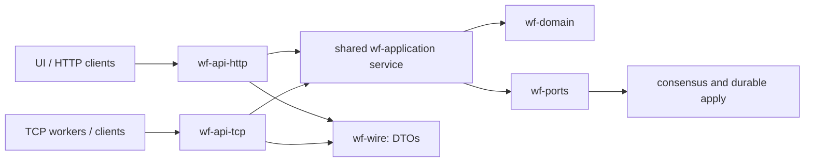

# HTTP and dedicated TCP workflow APIs

Status: reviewed design only, 2026-10-09. Three agents completed independent and reciprocal review; the [review record](reviews/transport-review-record.md) contains findings and resolutions. Both client transports are first-class targets of the Rust workflow service; neither is implemented. The shared contract in this document is authoritative across the detailed [HTTP](transports/http.md), [TCP](transports/tcp.md) and [operations/conformance](transports/operations-and-conformance.md) designs. The architecture, endpoint/frame profile, identity and outcome contracts are selected design choices. Numeric limits remain unvalidated proposed policy; exact operation schemas, selected library releases and measured latency remain implementation gates.

## Architecture and shared ownership

Expose HTTPS for browser/UI and ordinary integrations, and a dedicated TLS-over-TCP workflow protocol for long-lived worker/client connections. Separate listener addresses; no HTTP/TCP/Redis sniffing or fallback on one socket. Keep Raft peer traffic and cluster administration on separate internal capabilities/endpoints; client auth cannot submit Raft RPCs or membership changes.

Both adapters decode a bounded untrusted wire request into one application command/query facade. They receive the same node-owned service instance for tenant authorization, routing, cost admission, idempotency and submission. Separate frontend request/body/connection limits supplement that shared service; they do not grant a second tenant/group budget. Business logic, deterministic state changes, FIFO, lease guards, replay and durability stay in the application/domain/consensus layers.

| Boundary | Responsibility | Allowed first-party dependencies |
|---|---|---|
| `wf-wire` | Pure versioned public DTOs, operation/error tags, scalar encodings, capabilities and mapping of validated domain values | types, domain (approved value modules only) |
| `wf-api-http` | HTTP extraction/serialization, edge TLS/auth credential acquisition, request lifecycle | types, domain, wire, application |
| `wf-api-tcp` | Safe frame codec, connection/session state, call correlation, edge TLS/auth credential acquisition, request lifecycle | types, domain, wire, application |
| `wf-application` | Shared authorization/admission, validation, routing, command/query dispatch and reconciliation | types, domain, ports |
| `wf-node` | Listener configuration, shared service construction, wiring, supervision and drain | existing runtime/adapters plus wire/http/tcp |

This replaces the earlier single `wf-api` HTTP crate proposal, through [ADR-001](adr/001-dual-client-transports.md). Do not keep an empty forwarding crate for the old name. Worker is transport-independent through `WorkflowClientPort`; an HTTP or TCP client adapter implements that port. A client adapter must not link server adapters/storage/consensus. The initial worker crate may own small private transport modules; split client crates only where dependency policies or reuse justify it.

Diagram arrows show request flow here; the allowlist table is authoritative for code dependencies. `wf-wire` never imports application, ports, runtime, sockets, HTTP, storage or Raft. Adapters only name approved domain values and application public entrypoints; item/module capability checks prevent access through re-exports. No adapter can name raw transaction/log/consensus capabilities.

## Normalized request and response contract

A semantic request has protocol schema version, operation, authenticated/resolved tenant scope, typed arguments, optional read consistency/watermark, and transport context. Mutations in the new public APIs require a caller-stable durable request identity. Legacy no-ID workflow tests remain separate compatibility scenarios; adapters may not manufacture shared IDs to alter those assertions.

The proposed operation tags mirror workflow commands, for example `workflow.create`, `workflow.claim_due`, `workflow.complete`, `workflow.retry`, `workflow.get` and `workflow.history`. The HTTP endpoint or TCP message maps to a single registry; supported operations and modes must match between transports. Scope-gated governance/effect/step operations explicitly return unsupported until implemented; discovery cannot advertise them as working. A registry/test gate is planned, not implemented.

Keep three identities distinct:

- `request_id`: tenant/group-scoped durable mutation intent, retained for original-outcome replay. A retry through the other transport with the same normalized intent returns the same retained outcome, subject to current authorization.
- `call_id`: TCP connection-local response correlation, or HTTP attempt tracing identity. It never enters durable idempotency or workflow state.
- Workflow argument `correlation_id`: lineage/business correlation metadata; neither connection identity nor dedup key.

Canonical client-intent comparison happens after transport normalization. JSON whitespace/field order, HTTP routes/header casing and TCP encoding differences cannot cause a different digest for the same typed command. Preserve opaque bytes, guards, meaningful batch order, submitted schedule times and exact public partition semantics. Reject duplicate fields, malformed identifiers, invalid encodings and out-of-range values before admission. Exclude credentials, traces, routing hints, connection correlation and attempt timeout from the durable digest. The selected design candidate is SHA-256 over [version-1 typed intent](transports/intent-digest.md), owned by a pure application module; freeze operation mappings/defaults and cross-transport/cross-SDK vectors before publishing SDK retries. Do not hash raw HTTP/TCP bodies as equivalent intent.

Use decimal strings for public 64-bit counters/fences/revisions/log positions and other integers requiring lossless browser handling. Fixed-width TCP framing fields may be binary integers; their DTO equivalents are lossless strings. Preserve zero versus absent. Public opaque payload/result bytes have an explicit tagged encoding, with base64 for the JSON profile; transport serialization cannot reinterpret arbitrary bytes as JSON or UTF-8. Both encoded and decoded sizes are bounded, including base64 expansion and temporary parsing copies. Schema unknown-field/extension policy is explicit by version; no silent mutation-option acceptance. Wire structs are independent from persisted Raft commands and snapshots.

The common outcome vocabulary distinguishes durable accepted result, deterministic business rejection, definitive not-submitted edge rejection and uncertain result after submission may have occurred. Every rejection/response states the submission/outcome category where known, stable error code and request identity if available. A socket EOF, canceled HTTP future, timeout or failed response write is not proof that a mutation failed. Do not advertise a retryable failure when the correct result is outcome unknown.

Transport errors map differently to HTTP statuses and TCP message tags but preserve the semantic category. Queries use strong barrier or explicit projection freshness contracts and stable client write positions. Limits and health can be exposed without sensitive details; workflow tokens, credentials and payloads are redacted in logs/errors.

## Reviewed v1 contract

Both request bodies use `schema_version: "1"`, `operation`, `tenant_id`, typed `args`, `request_id` and `request_scope: {group_id, recovery_id}` for an individual mutation or whole atomic-group batch, optional `consistency`, and `attempt`. An independent-batch envelope has no durable outer request ID: every item has its own request ID, request_scope and normalized intent, with caller-ordered per-item outcomes. A batch attempt/correlation is transport context only. No implicit durable batch orchestrator or all-or-nothing contract is invented.

HTTP's path tenant must equal the required body tenant; mismatches reject before any proposal. TCP uses the same object after handshake, while header `call_id` remains transport-only. No duplicate `command`/`args` or `type`/`workflow_type` aliases are accepted in v1.

Before a first mutation, the client obtains an authorized stable group/recovery scope and journals it with request_id and intent. Initial single-group capabilities/discovery can provide that scope; future multi-group placement resolution is a bounded query, not membership authority. Every proposal validates the supplied scope against authoritative placement immediately before handoff, including after queue/poll wake and trusted forwarding. An already submitted owner remains pinned to its original namespace; restore cannot reassign that outstanding command into the new one. Retry retains it unchanged: old/incompatible recovery or group rejects before proposal, without filling in the latest namespace or moving the request to another group. A missing lost-response outcome is never a reason to silently create a new scope/ID. Read-only queries do not require mutation request_scope; outcome lookup and freshness positions carry their own explicit scope.

Create uses `args.workflow_id`, `workflow_type`, `initial_state`, partition and payload metadata. Request attempts use `attempt.timeout_ms`; optional bounded claim wait is attempt context, not a different durable command intent. Reads use `consistency: {"mode":"strong"|"projected","after":position}`. A position has `group_id`, `recovery_id` and lossless decimal `index`; projection-local generation is a separate field. Scalar/command-specific limits and optionality are explicit in the future typed schema, not generic dictionaries of arbitrary options. V1 does not accept a client-supplied intent_digest field; the application computes it. Replies expose intent_digest {normalization_version, algorithm, value} and outcome_retained_until_ms where the retained guarantee applies.

| Outcome | Submission | Meaning |
|---|---|---|
| `applied` | `durable_outcome` | Known committed, applied and persisted mutation success |
| `rejected` | `durable_outcome` | Known deterministic rejection retained with applied checkpoint; no successful workflow change |
| `not_submitted` | `not_submitted` | This attempt is proven not to have reached proposal; not a claim that another attempt with this identity cannot commit |
| `unknown` | `may_have_been_submitted` | Submission may have occurred; reconcile or repeat original intent/identity |
| `read` | `not_applicable` | Query result with explicit consistency/freshness; does not imply a workflow mutation |

TCP reply objects and HTTP success/problem extensions share these exact `outcome`, `submission`, `request_id`, `request_scope`, `error.code`, position, retention and reconciliation fields. Echo validated request_scope whenever known, including an unknown outcome; do not expose unauthorized topology or fabricate scope after failed validation. HTTP adds standard problem fields/status presentation; TCP adds frame correlation. Error codes are one typed shared enum; an uncertain mutation uses error.code outcome_unknown, with any deadline/connection cause reported separately; a stale lease can be an edge validation failure or a durable rejected outcome depending on where the proof occurred, and the submission field must reflect that. Intermediary HTTP errors or interrupted TCP replies lacking a validated envelope supply no non-submission proof.

Initial TCP design is FWTP/1: a fixed 24-byte network-order header (`FWTP`, version, kind, flags, lane, call, body length) and bounded JSON body. It is deliberately a new workflow-only profile with no FSNP/RESP/generic KV fallback. Ordered lanes serialize calls within a lane; other lanes run concurrently. An uncertain submitted outcome retires its lane for the connection; the client reconciles before dependent work on a new lane/connection; no cross-connection commit-order promise exists. Exact kinds/negotiation/error-close behavior are in the TCP spec. HTTPS supports HTTP/1.1 and HTTP/2 on separate listeners from TCP and internal Raft. Production proposes TLS 1.3 with no early data, HTTP ALPN `h2`/`http/1.1` versus TCP `wf-tcp/1`; verifier policy, credentials and session/ticket stores remain isolated from Raft/admin and from differing client-auth policies. No sniffing or silent downgrade is allowed.

The proposed operating profile uses at most 16 active calls and 24 unresolved data calls per connection, with at most 8 queued and bounded parked waiters still charged against unresolved count. A 5-second default attempt/30-second cap is shared. Frame/ordinary reply cap is 1 MiB encoded with narrower decoded opaque limits; node, tenant and client receive bounds can only reduce effective maxima. Advertised call concurrency is an upper bound, not guaranteed capacity: byte reservations and shared node/group/tenant admission may bind first. Unvalidated numeric assumptions remain workload/release gates and must not change preserved workflow assertions.

Node parked-waiter caps are separately 128/node, 64/group, 16/tenant, 8/worker and 8/connection with at most 16 registered scope keys per waiter; the operations design specifies an 8 MiB slice inside request-state capacity, 8 KiB metadata/waiter, 256-byte scope keys and bounded coalesced wake dispatch. These are candidate bounds, not measured resource safety. Their wait duration is distinct from the 10 ms ordinary admission queue. Long-poll capability is enabled equally on both transports per rollout, or both explicitly reject that mode.

## Shared execution lifecycle

1. Reserve bounded edge buffers/connection slots before reading untrusted body/frame sizes; enforce handshake/header/body progress deadlines.
2. Establish TLS/auth identity and resolve tenant. Per-operation authorization is performed in the shared application boundary; a TCP session principal is not perpetual authorization after expiry/revocation.
3. Decode/validate, check advertised operation/schema, and compute normalized intent. An ordinary bounded admission queue owns queue/input-state reservations without active execution permits. On fair dispatch, atomically acquire shared execution/cost and worst-case response resources before submitting work; transfer byte ownership without double counting. Parked claim waiters use their independent ledger.
4. Route/forward with the same request identity, original group/recovery scope and remaining deadline through trusted endpoints only. Internal forwarding preserves authenticated scope; client routing hints never grant membership authority.
5. Application/consensus execute the same workflow decision and durable write path. Successful mutations reply only after committed application and required persistence.
6. Map the typed outcome to HTTP/TCP and release resources by ownership lifetime. Slow/lost client writes cannot stop reconciliation of already-submitted work or release its execution permit early.

An attempt deadline bounds admission/response waiting, not Raft commit or disk fsync. Before proposal, a coordinated submission state machine can prove not-submitted and reject. Once proposal might have happened, deadline/disconnect/cancel leads to uncertain result unless the retained outcome is known. Reconcile/query or retry the same durable identity; current strong lookup absence alone is not proof an in-flight attempt cannot still commit. Lookup is a read with a state of applied, rejected, not_observed, expired, incompatible_recovery or unavailable; a found record nests the retained mutation outcome. Missing alone cannot prove expiry or prior existence: expired requires bounded tombstone/expiry-frontier evidence, otherwise report not_observed with unknown retention guarantee. No missing/expired lookup authorizes an automatic new-ID mutation. Exact retention duration and proof lifetime remain gates in the detailed specs. Transport cancellation never performs workflow.cancel, revokes a lease or rolls back a committed transition.

Long-poll claim waiting is a bounded application facility outside Raft apply. It parks only a bounded waiter with its auth/deadline/context and wake token, not an authoritative lease. On wake, revalidate and acquire execution/response admission, then submit an ordinary claim. One logical claim execution finalizes one durable request identity, including a committed empty result. Retransmission/failover may produce duplicate Raft entries; apply must replay the retained outcome and never select another claim for that ID. This is not an at-most-once-log-entry guarantee. Long-poll hints/rechecks do not submit repeated empty claims under one ID. Waiting with no proposal can end with a definite not-submitted wait result; the client may start a new attempt. Poll cancellation removes the waiter if unsubmitted; a race with claim proposal follows uncertain-outcome rules. Fast commands must retain capacity while long-poll waiters are parked. A replayed claim retains its original outcome, but a worker must establish current lease ownership/revision/fence authority before resuming work; an old lease deadline alone does not authorize external execution.

TCP pipelining and HTTP concurrency do not imply arrival/commit order across calls/connections. A client needing a causal chain waits for an outcome and uses returned revision/position or an explicit ordered batch contract. Frame/response order does not itself establish workflow FIFO; authoritative lane rules still control claim order. Batches declare atomic single-group or independent per-item mode; cross-group atomic requests reject without partial submission.

## Overload, latency and operational limits

Bound connection counts, unauthenticated buffers, read assembly, decode workers, active calls, shared tenant/group work, long-poll waiters, output bytes and background I/O. Put bounds on bytes and cost as well as counts; a bounded channel of large objects is not a memory bound. Control responses use separately reserved small capacity so a slow-reader/overload path need not allocate an unbounded error. Session byte maxima are acquired lazily from shared pools, not preallocated for every connection. Counts are upper bounds: the stricter byte/cost reservation can admit fewer calls. A negotiated client receive maximum caps the complete serialized result before proposal; page supported queries or reject an indivisible incompatible mutation before it changes state. If safe bounded error delivery is impossible, close with no success claim.

Protect p99 by limiting admission and queue time, per-tenant fairness, bounded command/index work, bounded batching delay and isolation from snapshot/GC/query traffic. HTTP and TCP draw from the same per-node backend budget so extra connections on that node cannot bypass tenant limits. These are resource-protection limits, not a cluster-wide quota entitlement; distributed quotas require a separate authority/design. Maintenance reserve is a slice of the total budget rather than additional unaccounted capacity. Raft/disk stalls require availability/unknown-outcome behavior, not an unconditional successful-write latency promise. Define SLOs for operations/payloads/topology/load and track rejection/availability alongside successful latency. No p99 number or throughput improvement has been measured.

Drain is shared service policy: stop new ordinary/create/claim work and detach unsubmitted parked claims, retain bounded authorized lease-maintenance/report/reconciliation capacity, then stop all new work and close after submitted supervision or the finite drain deadline. Control CANCEL/PING does not create workflow-maintenance authority. A cancellation acknowledgement and the target call's one terminal reply are separate; an acknowledgement never proves a submitted mutation was undone.

Middleware is a building block, not the full admission policy. Tower provides [concurrency limits](https://docs.rs/tower/latest/tower/limit/index.html) and [load shedding](https://docs.rs/tower/latest/tower/load_shed/index.html); custom shared tenant/group/byte/cost accounting and submission-lifetime ownership must be validated. Tokio-util's [length framing](https://docs.rs/tokio-util/latest/tokio_util/codec/length_delimited/index.html) is useful, but a declared frame-size cap alone does not reserve aggregate connection memory before allocation. Prefer safe APIs and audited TLS libraries such as [rustls](https://docs.rs/rustls/latest/rustls/); dependency unsafe remains subject to the existing audit policy.

## Required conformance and architecture tests

Retain all included Elixir workflow scenarios and assertions in the [existing acceptance contract](workflow-test-parity.md). Add shared fixtures executed through HTTP and TCP against isolated equivalent stores: create/claim/result, FIFO/lease/retry negatives, signals/schedules/children, history/query freshness, payload omissions and transaction boundaries. Cross-transport retained request replay/conflict, stale request_scope after disaster restore, and public field/error encodings are mandatory. A UI helper is not a substitute for server tenant authorization or committed precondition checks.

Add adapter-specific framing/streaming/malformed-input tests, slow readers and bodies, pipeline/concurrency ordering tests, byte-budget exhaustion, auth expiry, waiter cancellation races, routing/failover/unknown outcomes and drain recovery. Test that faults were hit and permits/buffers are neither leaked nor released before submitted work ends. Keep internal peer/auth capabilities inaccessible from client ports. Negative architecture fixtures reject transport-to-storage/consensus/raw-port edges and shared-wire imports of runtime or effect crates.

Release benchmark profiles exercise both transports together, with offered-load schedules that include queued/timeout/retry requests, large/cold replies, tenant skew, background snapshots, disk stalls and leader loss. Separate external workflow execution time from service mutation latency. Correctness/durability expectations are identical across benchmark variants.

## Preimplementation gates

Freeze reviewed endpoint/operation mappings, TCP frame/codec/negotiation, schema/digest vectors, error/unknown taxonomy and effective limit profile. Validate safe bounded parsing/body acquisition, credential lifecycle and trusted forwarding. Prove submission/cancellation resource ownership, waiter wake/admission, response-reservation behavior and replay after lost responses. Pin library versions/features and run conformance/fault/resource tests. These are planned work, not implemented guards or measured guarantees.
